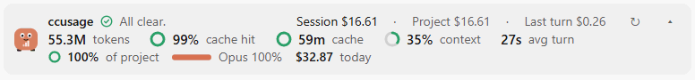
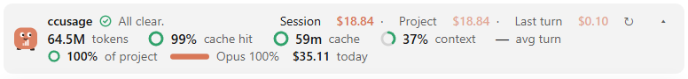

# ccusage-bar

A clean usage bar above the prompt in Claude Code, powered by [ccusage](https://github.com/ryoppippi/ccusage).

It shows what your Claude Code sessions cost and how they use tokens, for this session, this project folder, or just the last turn, with a small animated character, Tally, that reacts to how full your context is.



<details>
<summary>Still screenshot</summary>



</details>

## What it shows

**Header:** **Session**, **Project** and **Last turn** switch the view, and each shows its cost: this session, this project folder, and your most recent message.

**Top row**
- **tokens:** every token the session or project used (input, output, cache writes and cache reads).
- **cache hit:** the share of input served from the prompt cache, which costs about a tenth of normal input. Higher is better.
- **cache:** time left before the prompt cache expires (1 hour on subscriptions, 5 minutes on the API). Your next message after it runs out pays full price to re-read the conversation.
- **context:** how full the context window is. Near 100%, Claude Code compacts the conversation.
- **avg turn:** how long Claude works on a prompt in this session, on average (stopped turns left out). It's kept when you exit and resume the session. Not shown in Project view.

**Bottom row** (open by default; the ▴ / ▾ arrow at the end of the header hides and shows it)
- **of project / sessions:** this session's share of the project's cost, or the project's session count.
- **Model mix:** how the cost splits between Opus, Sonnet and Haiku.
- **today:** everything since midnight, across all projects.

**Last turn view:** the top row shows how long the turn took, how many tool calls it made, the tokens it read (in) and wrote (out), and its cache hit rate; the bottom row shows its share of the session's cost, its model, today, and the average turn time.

**Tally**, the character, bobs and blinks normally, turns worried at 70% context and alarmed at 85%, and looks busy while Claude is working.

All costs are estimates from your local logs; your bill is the authority.

## Bookkeeping

The mod keeps a record of every prompt in every project: time, tokens and cost by model (subagents apart), context size, effort, tool calls by tool, tool errors, MCP servers, skills and add-ons used or available, compactions, cache expiry, and the first 100 characters of the prompt. Everything stays on your machine, capped at 20 MB.

The point is to answer questions like "does graphify save tokens?" or "do mixed-model prompts save my limit?". Ask Claude in this project; it reads the records with [`dashboard/metrics.mjs`](dashboard/metrics.mjs), and [`docs/METRICS.md`](docs/METRICS.md) lists every field and the traps to avoid when comparing.

## Dashboard

**📊 Dashboard** in the bar's header (or `/ccusage-bar dashboard`) opens a page in your browser with every project and session you've run in Claude Code:

- **Charts over time:** average turn time (with ▲ markers where MCP servers were used), tokens (fresh input, cache writes, cache reads, output), cost by project, model mix by family or by model (share of cost or of tokens), cache hit rate and activity.
- **Navigation:** pick a project in the sidebar, or open a session from the sessions table to see it turn by turn. The browser's back button works, and each view has its own link.
- **Tools & add-ons:** the MCP servers, skills, subagents and add-ons (such as graphify) each project or session used. Click one to see only the sessions that used it.
- **Period:** 7 days, 30 days, 90 days, a year, or all time.

**Compare projects** (the tab at the top of the dashboard, or `/ccusage-bar compare`) puts your projects side by side and shows what each add-on, MCP server, skill and model does to **cost per turn** or **turn time**:

- **Compare:** *Same projects* compares sessions that used it with sessions that didn't, inside the projects that have both, then averages over those projects. *Before vs after* compares each project's turns before it was first used with the turns after. *Everything* pools all turns: simplest, but differences between projects can mislead.
- **Normalize:** divide each turn's figure by its context size (tokens Claude was reading) or by your prompt's length, so big projects and long prompts don't look worse just for being big.
- **Show** picks one table at a time: *Add-ons, MCP & skills*, *Model mix*, or *Projects*.
- **Model mix** compares mixed-model prompts (two or more model families each doing 5% or more of a prompt's cost, such as Opus with Haiku subagents) with single-model prompts, each model family's prompts with the rest, and lists every combination of models with its median and its difference from single-model prompts.
- Click a row to see it project by project. Results are medians, show their sample sizes, and say *few data* when there isn't much to go on.
- The projects table shows prompts, median cost or time, prompt length, context size, the folder's size (files and MB), model mix, and the add-ons, MCP servers and skills used.

How it gets its data:

- It reads Claude Code's own session logs (`~/.claude/projects`), so your history from before you installed the mod shows up too. Turn times from the logs are estimates: the time from your message to Claude's last reply.
- From now on the mod also records each turn as it finishes, with its exact time. Those records and the imported history are kept in the plugin's data folder, so the dashboard keeps your history after Claude Code deletes old logs (after 30 days by default). The mod imports the logs once a day in the background, so this works even if you never open the dashboard.
- The saved metrics are capped at 20 MB. Past that, the oldest sessions are folded into daily totals, so long-term charts keep working.
- Costs come from ccusage, split across each session's turns.
- The page is a single file with your data built in; nothing leaves your machine. Press **📊 Dashboard** again to update it. Charts load Chart.js from cdnjs, so the first view needs an internet connection.
- The desktop app's own tools (its task list and summary box) count as MCP servers named `ccd_*`. The dashboard leaves them out of the MCP markers unless you tick **Count the app's built-in MCP tools**.

## Requirements

- Claude Code with mod support. The full bar with gauges and Tally draws in the Claude desktop app; terminals get a compact text line.
- [ccusage](https://github.com/ryoppippi/ccusage) installed and on your PATH:

  ```
  npm install -g ccusage
  ```
- [Node.js](https://nodejs.org) on your PATH for the dashboard (ccusage needs it too).

## Install

At the prompt of a Claude Code terminal session:

```
/plugin install ccusage-bar --marketplace Ianpro1/ccusage-bar
```

Answer `y` to add the marketplace, then pick a scope.

From a shell:

```
claude plugin install ccusage-bar --marketplace Ianpro1/ccusage-bar
```

In the desktop app, where `/plugin` does not run: click **+** next to the prompt box, then **Plugins**, **Add marketplace** with `Ianpro1/ccusage-bar`, then **Add plugin**.

## Commands

- `/ccusage-bar hide` hides the bar.
- `/ccusage-bar show` brings it back.
- `/ccusage-bar refresh` re-reads the figures (they also refresh every minute and after each turn).
- `/ccusage-bar dashboard` builds the dashboard and opens it in your browser.
- `/ccusage-bar compare` opens the project comparison.

## Credits

Built with Claude Code. Usage figures come from ccusage by ryoppippi. The layout is inspired by the status bar of [token-optimizer](https://github.com/alexgreensh/token-optimizer); the code and the Tally character are original.
